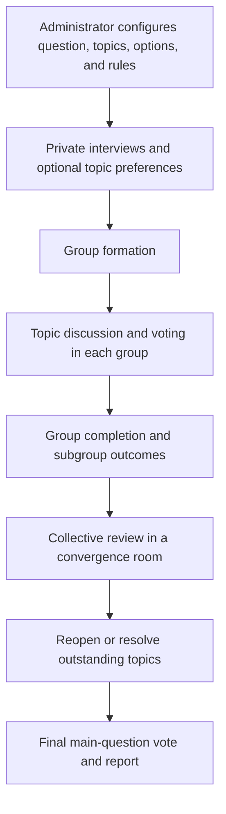

# CIME: implementation, administration, and research guide

> Account creation, multi-admin hosting, invitations and database setup now follow [README.md](README.md) and [PLATFORM.md](PLATFORM.md). The decision-engine rules and controls described below still apply.

This guide describes **Collective Intelligence Made Easy (CIME)** as implemented in this repository. It is intended for administrators running deliberations, developers extending the application, and researchers designing experiments with its simulated participants. The [README](README.md) provides a shorter installation reference; this document explains the behavior behind the controls.

The descriptions below follow the public application's source code. References explain the intellectual background of particular methods; they do not imply that CIME reproduces another system or that its behavioral assumptions have been empirically validated. Defaults and limits refer to this version of the code and can change in later versions.

## Contents

1. [Purpose and decision workflow](#1-purpose-and-decision-workflow)
2. [Codebase and runtime architecture](#2-codebase-and-runtime-architecture)
3. [Users, rooms, authentication, and participation](#3-users-rooms-authentication-and-participation)
4. [Voting and collective review](#4-voting-and-collective-review)
5. [Administrator interface](#5-administrator-interface)
6. [Decision settings reference](#6-decision-settings-reference)
7. [Simulation page and synthetic participants](#7-simulation-page-and-synthetic-participants)
8. [The simulated behavior model](#8-the-simulated-behavior-model)
9. [Quality page and measurement](#9-quality-page-and-measurement)
10. [Deliberative-quality computation](#10-deliberative-quality-computation)
11. [Logs, database, and exports](#11-logs-database-and-exports)
12. [Tutorial: install and run CIME](#12-tutorial-install-and-run-cime)
13. [Tutorial: configure and document an experiment](#13-tutorial-configure-and-document-an-experiment)
14. [Extending and diagnosing the application](#14-extending-and-diagnosing-the-application)
15. [Research references](#15-research-references)

## 1. Purpose and decision workflow

CIME connects discussion to a recorded decision procedure. An administrator supplies a main question, contextual information, and a set of deliberation topics. Participants first express their views privately, then discuss in smaller groups, and finally review subgroup outcomes together. Language models facilitate communication; database-backed operations manage memberships, ballots, deadlines, and transitions.

A useful example is a public-square renovation. The main question might ask whether to support the resulting renovation, while the deliberation topics separately address cycling space, parking, and planting. Agreement on one topic need not imply support for the entire proposal. The final question is therefore distinct from the topic ballots.



### Private interviews

Each participant has a personal room. The facilitator asks about the configured topics and collects answers. When enabled, validity assessment distinguishes substantive responses from clarification requests or irrelevant input. Invalid responses can be asked again once; repeated invalidity advances the interview rather than creating an unlimited retry loop. Topic-preference selection can additionally identify which discussions interest the participant.

This is an elicitation stage, not an opportunity for the facilitator to decide the outcome. The agent instructions constrain how it asks questions and distinguish private elicitation from group facilitation. Extracted preferences become structured context for later grouping and conversation.

### Group discussion

After the collection stage, Agent 2 assigns participants and topics to discussion rooms. Each room addresses its assigned topics in sequence. The facilitator requests reasons, responds to questions, and can invite further contributions after inactivity. Voting and discussion are connected, but the existence of a conversational statement such as “we agree” does not itself constitute a valid ballot result.

Group composition depends on the configured strategy. Topic-preference grouping balances expressed interests against coverage and room-size constraints. Other strategies construct groups without using preferences or use similarities and differences in participants' views. Record both the selected strategy and the actual room assignments: the requested configuration does not, by itself, describe the population that ultimately discussed each topic.

### Collective review

A convergence room brings participants back together. Its opening summary presents subgroup outcomes. During the review window, participants can register agreement or ask to reopen a topic. Voting remains locked during this review. When the window ends, or the early-agreement condition is satisfied, reopened and outstanding topics proceed through the relevant discussion and voting process before the final main-question ballot.

CIME can finish with acceptance, rejection, or a procedural outcome that does not establish substantive agreement. Researchers should distinguish successful software execution from endorsement of a proposal.

Research on AI-mediated common-ground statements provides useful background, particularly [Tessler et al. (2024)](https://doi.org/10.1126/science.adq2852). CIME's contribution is a different integration of facilitation with rooms, ballots, and workflow rules; that study's findings are not evidence of CIME's effectiveness.

## 2. Codebase and runtime architecture

The repository contains three independently installed Node.js packages and a small root package with convenience commands. The backend is an Express application; the two browser applications use React and Vite. Socket.IO distributes live events, and SQLite persists the process.

| Location | Responsibility and useful entry points |
| --- | --- |
| [backend/src/server.js](backend/src/server.js) | Initializes the database, Express routes, Socket.IO server, optional TLS, and workflow monitoring. |
| [backend/src/config/env.js](backend/src/config/env.js) | Reads server configuration, validates the JWT secret, defines model defaults and allowed origins. |
| [backend/src/config/db.js](backend/src/config/db.js) | Opens SQLite, enables foreign keys and WAL mode, creates/migrates tables, and manages personal-room initialization. |
| [backend/src/routes/admin.js](backend/src/routes/admin.js) | Administrator API, process startup, settings, users, rooms, simulations, statistics, database inspection, and exports. |
| [backend/src/routes/rooms.js](backend/src/routes/rooms.js) | Participant room access, messages, ballots, suggestions, recaps, and convergence-review actions. |
| [backend/src/routes/decision.js](backend/src/routes/decision.js) | Participant-facing process status and agent explanations. |
| [backend/src/socket/socketManager.js](backend/src/socket/socketManager.js) | Authenticated real-time communication, room membership, message handling, and activity tracking. |
| [frontend/src/App.jsx](frontend/src/App.jsx) | Participant routes: login, dashboard, chat, agent monitor, and documentation. |
| [admin-frontend/src/pages/AdminDashboard.jsx](admin-frontend/src/pages/AdminDashboard.jsx) | Administrator navigation and most management pages. |
| [admin-frontend/src/components/SimulationTab.jsx](admin-frontend/src/components/SimulationTab.jsx) | Simulation configuration, persona editing, AI autofill, and execution controls. |
| [admin-frontend/src/components/QualityTab.jsx](admin-frontend/src/components/QualityTab.jsx) | Quality cards, filters, charts, comparisons, opinion flow, and data download. |

### Three cooperating services

[Agent 1](backend/src/services/agent1Service.js) produces participant-facing dialogue using room instructions, the active topic and poll, and recent conversation. It performs private elicitation and group facilitation in different contexts. Its prompt context is bounded; it is not an unlimited transcript memory.

[Agent 2](backend/src/services/agent2Service.js) prepares facilitation instructions and organizes rooms. It reads the configured decision and participant preferences, applies the selected grouping approach, and establishes the context used by the conversational agent. Topic-preference assignment uses a backend heuristic; other preference-based strategies can call a language model.

[Agent 3](backend/src/services/agent3Service.js) coordinates collection, poll creation, vote resolution, room progress, and convergence. It uses LLM calls for tasks such as interpretation and candidate generation, but operates on recorded process state when applying voting rules. Most voting edge cases are implemented here, so this file is particularly important when changing the decision procedure.

These “agents” are cooperating service modules in one backend, not three autonomous servers. Conversational functions can span modules. Changing the model used by a task does not replace the backend's vote-counting implementation.

### Model calls, shared state, and cancellation

[llm.js](backend/src/services/llm.js) wraps chat and embedding requests, resolves task-specific model overrides, and records successful calls. The effective model can differ from a broad default if a caller-specific override is saved. Inspect the actual call log when recording model use in an experiment.

[decisionWorkService.js](backend/src/services/decisionWorkService.js) assigns a run identifier and a generation of scheduled work. A restart or interruption invalidates earlier work, helping prevent delayed responses from advancing a superseded process. [workContext.js](backend/src/services/workContext.js) carries cancellation and run context through asynchronous operations. [sharedAnalysisService.js](backend/src/services/sharedAnalysisService.js) shares identical in-flight analyses among requests, while completed assessments are cached in SQLite.

The architecture assumes one coordinating backend process. SQLite persistence does not make the in-memory timers, simulation memories, and work-generation counters a distributed scheduler. Separate deployments are preferable when independent experiments must run concurrently.

## 3. Users, rooms, authentication, and participation

### Accounts and authorization

CIME uses administrator-provisioned accounts rather than public self-registration. Passwords are hashed with bcrypt. The public repository's initial administrator setup requires a supplied username and password and refuses to overwrite an existing account. Subsequent accounts are created in the Users page or through the simulation participant controls.

Login is implemented in [auth.js](backend/src/routes/auth.js). A successful login returns a JWT with a 24-hour expiry. Browser authentication contexts store login state locally. The backend checks each token against the current account record; administrator routes require its current administrator role. Deleted accounts lose API access and their connected sockets are disconnected. Inactivity removal also revokes the room subscription on the server. The initial administrator setup enforces a stronger minimum password length than the general account-creation API, which currently accepts passwords from six characters. Use appropriately strong passwords for real accounts regardless of the API minimum.

Administrators have substantial access to process data, including logs and database inspection. Personal rooms are private relative to ordinary participants, not inaccessible to administrators. Participants should be told what is retained and who can inspect it before a human study begins.

### Memberships and visibility

The `room_members` table connects accounts to rooms. Personal-room initialization creates the participant's room and associates the appropriate accounts. Group formation replaces or changes memberships as the process advances. Ordinary participants only obtain authorized room information; they cannot use the administrator interface to assign themselves to another room.

Administrators may observe rooms as administrative members. The ordinary room-message socket handler rejects administrator chat messages; administrative bot-message and console operations are separate interventions. These observers are excluded from the intended participant counts used by normal voting and participation logic. When reconstructing an experiment, distinguish administrative memberships from actual participants.

Membership can change because of regrouping, progression to convergence, or inactivity removal. The resulting room population is therefore not necessarily the complete `users` table. A registered account that is not active in a simulation should not be treated as a simulated participant.

### Participant interface

The dashboard lists assigned rooms and links to the Agent Monitor. The chat page renders messages, bot contributions, room status, active polls, timers, and recaps. Poll components provide the controls required by the current ballot type. The message handler permits discussion while a mandatory poll is open, so participants can ask questions and explain their selections. Ballot expiry and vote validity are checked separately by the voting endpoint.

Participants can review outcomes, interact with the convergence summary, and propose alternatives where the active voting stage permits it. The Agent Monitor provides a simplified process explanation rather than the administrator's complete operational view. Documentation is available through the participant route as well as the administrator page.

### Inactivity and process repair

The inactivity setting governs warnings after a period without relevant activity. The implemented warning gives an additional minute to interact before removal. Membership removal can change the number of eligible voters, so it can affect quorum and approval requirements. Inactivity is not a neutral display preference in an experiment.

The Rooms page includes operations for removing discussion groups and restoring personal memberships. These are management operations, not substitutes for exporting a run. Deleting a user or room can alter the evidence remaining in the database.

## 4. Voting and collective review

### 4.1 Readiness is different from approval

Before a conversational readiness check can open a poll, the backend may require contributions from a configured fraction of distinct non-administrator participants. `consensus_sensitivity` ranges from 1 to 10 and maps to 10% through 100%, rounded up to a participant count. The subsequent LLM check considers the discussion. This is not the ballot's approval threshold, and repeated messages from one participant do not substitute for contributions from distinct people.

Automatically scheduled topic handoffs and timer-driven transitions also exist. Consequently, not every poll opening should be interpreted as a positive finding from the conversational readiness assessment. Preserve the event log when studying why a particular ballot opened.

### 4.2 Initial approval ballot

The initial topic stage is a swipe ballot: participants approve or reject individual options. This is not a single mutually exclusive choice; a person can approve multiple alternatives. A unique leader meeting the relevant threshold can settle the topic. Otherwise the workflow advances to live voting. The implementation filters control options and carries substantive approved alternatives forward, with fallback handling when the candidate set is insufficient.

Topic swipe and ranking ballots use `poll_timer_minutes`. Personal collection polls are handled differently and can have no expiry. The final main-question ballot also has a separate timing rule.

### 4.3 Revisable live voting

A live ballot uses poll type `continuous`. Each participant has one current selection, which can be replaced before closure. The current row in `poll_votes` determines the tally; `poll_vote_history` records replacements for later inspection. History rows must not be counted as additional simultaneous votes.

Live closure has four requirements: enough elapsed time, quorum, sufficient support for the leading option, and sustained satisfaction of the thresholds for a stability interval. For `n` eligible non-admin room members:

```text
quorum_required = max(1, ceil(n × minimum_votes_for_approval / 100))
approval_required = max(1, ceil(n × approval_share))
approval_share = 0.51, 0.75, or 1.00 for threshold levels 1, 2, or 3
```

These formulas describe the ordinary positive-population case in `getContinuousMetrics`. Approval uses the eligible population as its denominator, not only those who have voted. With eight eligible participants, a 75% approval threshold requires six votes for the leading option. A 50% quorum requires four participating voters, but meeting that quorum alone does not satisfy approval.

The minimum duration and stability interval prevent immediate closure on a transient tally. Setting the minimum live duration equal to the total live duration removes the opportunity for an earlier close. Membership changes and vote revisions can change whether the thresholds are satisfied.

### 4.4 Participant suggestions

The live interface retains a control for proposing an alternative. The backend validates proposed text and checks for duplication or spam. Suggestions have their own records and can be associated with a canonical option rather than becoming independent duplicate candidates. A per-user cooldown and pending-suggestion control reduce repeated submissions.

`maximum_visible_options` limits the principal list, not the historical universe of options. A participant's selected option can remain visible even if it falls outside the principal list. Stable option identifiers are important: text labels alone are not a reliable key for reconstructing selections, especially after canonicalization.

### 4.5 Timeout, review, and ranking

When live voting times out without stable agreement, the backend stores a snapshot and enters a one-minute review before ranking. The review is part of the voting transition; refreshing a browser does not restart its deadline. The ranking candidate set includes leading substantive options and retained selected alternatives. If there are not enough valid candidates, the backend can leave the topic open rather than create an unusable ranking poll.

Ranking applies a Borda count. For `m` options, an option placed at rank `r` receives `m - r + 1` points. Ranking ties are ordered by the stored option identifier. When no ranking votes are cast, the current implementation defaults to the first stored candidate, described in the transition as the preceding leader. This is a procedural default, not evidence that participants endorsed it. Researchers should retain the recorded closure reason and distinguish this case from an ordinary voted outcome.

The database separates `poll_type`, `poll_stage`, `chain_stage`, expiry, closure reason, review deadline, and the successor poll identifier. These fields are more informative than counting polls alone: several records may belong to one topic's decision sequence.

### 4.6 Final question and convergence

After topic review, a final ballot asks about the main question using the configured answer options. Supply explicit final options when their interpretation matters; do not assume a Yes/No ballot if the configuration leaves them unspecified. This ballot uses `live_voting_duration_minutes` but does not run the topic's complete swipe–live–ranking sequence.

A final poll expiring with no votes records no expressed preference and permits progress. Negative responses, no response, topic-level agreement, and completion are distinct observations. The legacy `kick_out_no_voters` setting concerns “No” responses in parts of the workflow rather than simply missing a ballot; inspect its context before changing it.

## 5. Administrator interface

The navigation contains **Decision, Settings, Users, Rooms, Polls, Quality, Simulation, Documentation, Database, and LLM Logs**. The administrator dashboard orchestrates these pages, while the large Quality and Simulation components implement their specialized views.

### Decision

The Decision page contains the main question, decision context, general participant-facing description, deliberation questions, initial options, and final-question answers. Question and description generation controls call the configured language model. Review generated material before a study: changing topic wording or available answers changes the experimental treatment.

Draft fields are stored in browser local storage. A draft visible in the browser is not necessarily the configuration already running on the server. Start the process only after checking the fields and settings. The start operation initializes the run and resets substantial previous workflow data; export the previous run first.

This page also provides decision settings, broad primary/cheap model selection, clustering controls, saved-default operations, and JSON editing for supported settings. The Agent Console provides per-agent interaction and status. Some recognized administrator commands can change workflow state, such as advancing private collection; it is not solely a read-only chat. Requests containing instruction-related wording can save live guidance, and Agent 1 guidance is appended to active room prompts. The dashboard also has an administrative path for sending a bot message to a monitored room. Record these interventions when conducting experiments.

Live Room Monitoring shows room progress and operational information. Completion panels expose outcome information and access to recaps. Interruption and progression controls should be treated as interventions in the run, not as ordinary participant actions.

### Settings

The Settings page is a per-call model registry. Its table identifies a source file, call context, purpose, and assigned model. These overrides are stored in `llm_call_models` and resolved by the common LLM wrapper. A model selected for one broad task can be superseded by a saved caller override. Record the effective call models, not only the main model selector.

The browser selectors contain a predefined model list. Backend environment overrides can introduce an account-specific model default, but that does not mean every selector automatically discovers the provider's model catalogue.

### Users

The Users page lists accounts, creates users with a username/password and administrator flag, and deletes accounts. Account creation invokes personal-room initialization. The backend prevents an administrator from deleting their own currently authenticated account through the ordinary delete-user route. There is no general public registration or self-service password-reset workflow documented by these routes.

### Rooms

The Rooms page supports room creation, participant assignment, room deletion, and message clearing. Room management includes deleting discussion groups and restoring personal memberships. The room API also exposes state changes used by room controls. Membership editing replaces the assigned set, so carefully distinguish an intentional regrouping from an accidental removal.

### Polls

The Polls page creates and manages polls in a selected room, including options, visibility, closure, and deletion. Manual polls are administrative actions alongside the automated workflow. When comparing conditions, preserve evidence of manually created or modified ballots; they can change exposure, timing, and the number of decision opportunities.

### Quality and Simulation

The Quality page retrieves statistics and may trigger new assessments. The Simulation page configures and starts synthetic participants. Both are explained in detail below. Neither page should be treated as a passive report: the first can incur analysis calls, and the second can reset and run the process.

### Documentation

The Documentation page renders the bundled Markdown content from `src/docs/wikiContent.js`. The public copy contains a concise overview and participant/administrator help. This guide supplies the more detailed research and implementation reference. Updating this Markdown file does not automatically regenerate the browser's bundled documentation.

### Database

The Database page lists SQLite tables, shows columns and paginated records, supports sorting, and provides expanded inspection of long values. Its cleaning controls delete all rows or records older than a chosen age when the table has a recognized timestamp column. The supported age columns are `timestamp`, `created_at`, or `updated_at`.

This is a privileged maintenance interface. It can expose account hashes, transcripts, prompts, and internal state. Cleaning a table is not a reversible filter and is not a complete, coordinated experiment reset. Prefer exporting results and starting a new decision through the designated workflow.

### LLM Logs

LLM Logs shows recent calls, with limits of 50, 100, 250, or 500, and a manual refresh. Entries identify timestamp, room, caller, model, and token use. Expand a row to inspect and copy its prompt and response. The database contains additional usage/run fields described in Section 11.

The page is a history of recorded calls, not proof that every attempted request succeeded or was logged. Check server output and assessment provenance when diagnosing provider failures.

## 6. Decision settings reference

[agentConfigService.js](backend/src/services/agentConfigService.js) defines factory defaults, reads `settings.json`, normalizes values, and records updates. Saving a default writes a separate `default-settings.json`; resetting to default restores that snapshot if present, otherwise the factory values. It does not restore the database to an earlier run.

The JSON editor validates supported fields through [adminJsonConfig.js](admin-frontend/src/utils/adminJsonConfig.js). Its validation is stricter than simply sending arbitrary values to the backend. Unknown fields are rejected. Most numeric controls require integers. Always export or record the normalized values actually saved by the server.

### Main controls

| Setting key | Factory default; supported range | Implementation and experimental meaning |
| --- | --- | --- |
| `group_proactivity` | 4; UI/JSON 1–5 | Minutes of silence before a group nudge. Lower means earlier intervention. The runtime timing helper clamps to 1–5 even though the low-level scale reader accepts up to 6. Poll announcements do not count as substantive conversation for the silence timer. |
| `consensus_sensitivity` | 4; 1–10 | Minimum distinct-participant contribution fraction before the conversational readiness check: 10% per level, rounded up. Separate from vote approval. |
| `check_response_validity` | false; boolean | Enables the validity checks used by collection and relevant custom-text handling. Changes how irrelevant answers are retried or ignored. |
| `room_timer_minutes` | 3; 1–30 | Duration used by room-phase countdowns. A group countdown never discards topics: remaining ballots finish before the final question and convergence. It is not the duration of every ballot. |
| `poll_approval_threshold` | 1; 1–3 | Encodes 51%, 75%, or 100% approval. Use the encoded level, not the percentage, in settings JSON. |
| `minimum_votes_for_approval` | 50; 1–100 | Live-vote quorum as a percentage of eligible participants. |
| `minimum_live_voting_duration_minutes` | 1; 0–30 | Prevents early live closure before this elapsed time. |
| `consensus_stability_duration_seconds` | 20; 0–300 | Required continuous interval with live quorum and approval satisfied. |
| `live_voting_duration_minutes` | 5; 1–120 | Timeout for topic live voting and duration of the final main-question ballot. |
| `suggestion_cooldown_seconds` | 30; 0–3600 | Per-user delay between live suggestions. |
| `maximum_visible_options` | 8; 2–20 | Principal live-option list size; retained participant selections can appear beyond that list. |
| `poll_timer_minutes` | 2; 1–30 | Topic swipe and ranking ballot duration. |
| `convergence_summary_minutes` | 1; 1–10 | Opening review window in the convergence room, before voting is unlocked. |
| `time_before_poll_seconds` | 10; 0–120 | Pause after the next-topic announcement or final recap before the scheduled ballot opens. |
| `user_poll_rate_limit` | 11; 0–11 | User-requested poll limit per five minutes per room. 0 disables requests; 1–10 sets the limit; 11 means unlimited. Readiness rules still apply. |
| `user_inactivity_timeout_minutes` | 5; 3–15 | Inactivity period before a warning and the additional one-minute response opportunity. Removal can affect membership and voting thresholds. |
| `clustering_strategy` | `mixed`; enum | `random`, `homophilic`, `heterophilic`, `mixed`, or `topic_preference`. |
| `clustering_min_users_per_room` | 2; 2–50 | Intended minimum group size; feasibility depends on the selected population. |
| `clustering_min_rooms` | 1; 1–50 | Intended minimum number of groups; record actual assignments as well. |
| `primary_model` | empty string | Empty uses the backend primary default. Otherwise supplies the broad primary model setting. |
| `cheap_model` | empty string | Empty uses the backend lower-cost default. Caller-specific overrides remain relevant. |

### Active timing and compatibility notes

The active timing controls are `room_timer_minutes`, `poll_timer_minutes`,
`time_before_poll_seconds`, `live_voting_duration_minutes`,
`minimum_live_voting_duration_minutes`, and
`consensus_stability_duration_seconds`. `time_before_poll_seconds` is the
single hand-off delay after a next-topic announcement or final recap.

`kick_out_no_voters` defaults to 2 and accepts 1–2. Despite its name, relevant branches respond to a “No” answer, including a non-simulated participant's private general-question response. This is not the general inactivity timer.

### Grouping strategies

`random` shuffles participants before distributing them across rooms, without using expressed preferences. A simulation uses its run seed for this shuffle, so the same population and seed reproduce the grouping; ordinary human runs use fresh randomness. `homophilic` asks for groups with similar positions; `heterophilic` seeks contrasting positions; `mixed` balances similarity and difference. These strategy names describe the grouping objective, not a guarantee about the resulting discussion.

`topic_preference` uses selected topic interests and a backend assignment procedure to cover topics while forming viable rooms. Participants interested in all topics can help fill undersubscribed groups. Coverage and group-size feasibility may take precedence over an individual's first preference. Archive actual room membership and topic assignments to verify the manipulation.

## 7. Simulation page and synthetic participants

The simulation feature uses ordinary non-administrator accounts as synthetic participants. Their messages and ballots pass through application services and are stored in the same broad schema as human participation. A “human message” field in a chart means a non-bot contribution; it is not proof that a person typed it.

### Participant selection and creation

The page lists available participant accounts and provides activation controls. Only activated personas are sent to the full simulation start endpoint. The backend validates that their identifiers belong to existing non-admin accounts. Inactive accounts are not automatically simulated merely because they exist in the database.

Bulk participant creation accepts usernames separated by commas or newlines and a supplied shared password. This is convenient for synthetic accounts; use separate credentials and an appropriate account-management procedure for real participants. No actual passwords are needed in an experimental configuration archive.

Starting a simulation first validates the effective question configuration and prepares its facilitation instructions. Configuration errors and failed prompt generation leave the previous run intact. The database reset and new room preparation then commit in one transaction.

### Engine controls and stop phases

The Agent Model selects the requested dialogue model. The Run seed controls the simulator's keyed pseudo-random decisions. The three stop modes are:

| `stopAt` | Intended stopping point |
| --- | --- |
| `personal` | After private collection, ready for group debate. |
| `discussing` | After discussion groups, ready for convergence. |
| `convergence` | Through the complete convergence process. |

The first two modes support staged use, including a later handover to real users. They are not incomplete versions of the same experimental endpoint unless the study defines them that way. A full-run completion study should explicitly select `convergence`.

Starting a simulation initializes a new decision run and clears substantial preceding workflow state, including prior group/convergence rooms and associated discussion data. Stopping simulation is not an undo operation. Preserve the previous run before starting the next one.

The simulation loop waits for its asynchronous step to finish, then schedules another step approximately three seconds later. Calls within a step can run concurrently across participants and rooms. Provider latency therefore affects wall-clock behavior even with the same seed.

### Persona identity

Each persona has five OCEAN values in `[0,1]`, a free-text backstory, and topic-specific starting stances. A stance contains a `position` and an `intensity` in `[0,1]`. Backstories describe priorities and circumstances; stances describe issue-specific preferences. A personality profile and a political or practical position are different parts of the configuration.

The Big Five terminology follows [Goldberg (1990)](https://doi.org/10.1037/0022-3514.59.6.1216). CIME's values are simulation parameters, not questionnaire scores or population percentiles. Backstory conditioning is related to the use of conditioned synthetic respondents in [Argyle et al. (2023)](https://arxiv.org/abs/2209.06899), but fictional CIME personas are not automatically representative samples.

### Randomize OCEAN

Randomization occurs in the browser, does not call an LLM, and changes only activated participants. Each trait is sampled from a normal distribution with mean 0.5 and standard deviation 0.18, rejecting values outside `[0.15,0.85]`, then rounding to steps of 0.05. This is a conservative synthetic prior, not an empirically calibrated personality distribution.

The randomizer defaults to browser `Math.random`; it is not governed by the backend Run seed. Save the resulting persona JSON if the same population must be reused. Repeatedly clicking Randomize changes the experimental population.

### AI autofill

AI autofill generates backstories and stances while retaining the chosen OCEAN values. It can operate for one participant or across active participants. The page offers `mixed_perspectives` and `strong_disagreement` modes.

The backend builds a deterministic population assignment before asking the LLM to write persona text. It rotates supportive, skeptical, cost-focused, accessibility-focused, and implementation-focused lenses. The mixed mode requests moderate and conditional positions with overlapping interests. The strong-disagreement mode includes stronger support/opposition as well as conditional positions, with directions rotated by topic rather than assigning one person the same side on every issue.

These are generation instructions, not verified properties of the resulting population. Review generated stances, especially when the strength or balance of disagreement is an experimental manipulation. Generate once, inspect, and freeze the accepted result before repeating seeds.

### Advanced controls and preference seeding

Advanced persona fields can override conformity (`gamma`), argument responsiveness (`omega`), choice precision (`lambda`), and no-opinion probability. Leaving a field blank uses the personality-derived value. The JSON editor accepts gamma and omega in `[0,1]`, lambda in `[0,100]`, and no-opinion probability in `[0,1]`.

The separate Agent Preference Seeding area supplies topic option text used by simulation initialization. It is not identical to the persona's prose stance and intensity. Keep both when archiving a configuration, rather than assuming that one completely determines the other.

### JSON and persistence

The page serializes model, seed, stop phase, personas, and preference seeds. The portable JSON is keyed by **username**; the start request resolves those accounts to backend numeric IDs. Import requires existing usernames and recognized topic names. It validates the OCEAN fields and rejects unknown keys.

Browser local storage retains editable simulation configuration. The backend holds additional active simulation state and short memories in process memory. Neither browser storage nor the run-data export should be assumed to be a complete portable experiment definition. Save the Simulation JSON separately from Decision settings and run output.

### Fast Simulation (Mock Data)

Fast Simulation is a separate shortcut that inserts mock progress and supports stopping after discussion groups. It is useful for examining later interface states or manually trying convergence. It does not execute the complete persona-driven behavioral procedure. Do not combine mock-generated output with full simulation output when analyzing participant behavior, model effects, or execution time.

## 8. The simulated behavior model

The implementation separates what an agent says from when it acts and how it chooses. [simulationService.js](backend/src/services/simulationService.js) schedules actions, maintains short event memories, creates prompts, and submits activity. [simulationAgentModel.js](backend/src/services/simulationAgentModel.js) derives behavioral parameters and evaluates voting alternatives.

### 8.1 Personality mappings

For OCEAN values `O`, `C`, `E`, `A`, and `N`, the default mappings are:

```text
pSpeak   = sigmoid(6 × (E - 0.5))
pOther   = 0.6 × O
pAbstain = 0.3 × (1 - C)
gamma    = A
omega    = O
lambda   = (2 + 6 × C) × (1 - 0.5 × N)
delayTicks = round(3 × (1 - E))
wordCap    = round(15 + 85 × E)
```

Higher extraversion increases the speaking gate and requested message length. Low extraversion (`E < 0.2`) additionally requires a direct mention for later contributions, with exceptions for the initial contribution. `delayTicks` is operationalized through intervening messages, not a fixed number of seconds. A direct mention and the initial-contribution rule can bypass the ordinary speaking probability.

Agreeableness scales the peer-support term; openness scales argument alignment and the probability of proposing an alternative. Conscientiousness raises choice precision and reduces the default abstention tendency. Neuroticism reduces choice precision. These are explicit engineering assumptions. They are not claims that human personality has these exact causal effects.

The abstention gate also depends on ballot context. An explicit abstention option can be selected; an optional ballot can be skipped. Mandatory ballots without such an option do not necessarily realize the nominal `pAbstain` as a missing vote. Report observed abstention as well as the configured parameter.

### 8.2 Utility and choice

For participant `i` and candidate `k`, the implemented utility is:

```text
U(i,k) = betaPref × stanceAlignment(i,k)
       + betaSoc  × gamma(i) × currentSupport(k)
       + betaArg  × omega(i) × argumentAlignment(i,k)

P(i chooses k) = exp(lambda(i) × U(i,k))
                / sum_j exp(lambda(i) × U(i,j))
```

The three beta weights default to 1. Stance alignment is multiplied by stance intensity. Current support is calculated from recorded ballot activity: ordinary choices use choice shares; swipe support uses shares of right-swipes across options. It is not an independent opinion survey of everyone in the room.

Argument alignment uses recent messages that share tokens with an option label. If none match, the option label supplies the context. The participant's backstory and stated values are compared with this context. Despite an internal comment referring to “argument quality,” this term measures semantic alignment, not independently verified reasoning quality.

Embedding cosine similarity is mapped from `[-1,1]` to `[0,1]`. If embedding calls are unavailable or fail, the model falls back to token-overlap similarity. Similarity can fail to distinguish support from opposition to the same subject. Check consistency between generated statements, option interpretation, and actions rather than treating fluent dialogue as sufficient validation.

The softmax structure has a methodological connection to discrete-choice models such as [McFadden (1974)](https://eml.berkeley.edu/reprints/mcfadden/zarembka.pdf). CIME's coefficients are hand-specified; they have not been estimated from a human choice dataset.

### 8.3 Different ballot types

For a single choice, the model samples from the softmax probabilities. For ranking, it orders alternatives by descending utility. For swipe voting, it approves candidates at or above the uniform probability baseline `1/K`, always including an argmax candidate, and rejects the others. These are different decision rules, not repeated samples of the same single-choice mechanism.

Control options such as “Other” and “Keep discussing” are generally excluded from the substantive utility pool. Alternative proposal generation is handled separately. Normalization also contains fallback choices for malformed or incomplete decisions; these can affect behavior and should be considered when inspecting anomalous runs.

### 8.4 Dialogue, memory, and reproducibility

Prompts combine the persona, active stance, recent room transcript, extracted preferences, and short event memories. Memory retains up to twelve recent simulation events per participant. The implementation is related in motivation to agents with memory and contextual behavior, such as [Park et al. (2023)](https://arxiv.org/abs/2304.03442), but does not reproduce that paper's full reflection and planning architecture.

The backend seed is used in keyed pseudo-random decisions involving participants, polls, rooms, and observed activity. Identical seeds alone do not guarantee identical runs: regenerated personas, changed identifiers, different response text, timing, model revisions, and embedding availability can change the trajectory. The browser's personality randomization is another independent source of variation.

For reproducibility, preserve inputs, identities, prompts, model settings, runtime configuration, actual outputs, and source revision. Repetition reveals variation under an implementation; it does not establish human realism. [Aher et al. (2023)](https://proceedings.mlr.press/v202/aher23a.html) is useful background on evaluating what simulated respondents reproduce and where they distort behavior.

## 9. Quality page and measurement

The Quality page combines descriptive statistics, model-based assessments, and visual comparisons. Its statistics route operates on non-personal discussion scopes and excludes administrator contributions from the participant analyses. Topic and room-type filters change the population of records being summarized. The page offers time-series, topic-comparison, and room-comparison views, plus opinion-flow visualizations.

The statistics code is located in [admin.js](backend/src/routes/admin.js), beginning at the `/decision-process/statistics` route. The route reconstructs room populations from current memberships and historical participation because memberships can be removed during progression to convergence. A completely silent former member with no retained membership or activity can be difficult to reconstruct; archive the original assignments when equality or attrition is a study outcome.

### Cards and charts

| Indicator | Computation or interpretation |
| --- | --- |
| Participant messages and average words | Volume of non-bot contributions and their mean length. Neither demonstrates reasoning quality. |
| Bot messages | Facilitation and system-style message volume, including operational announcements. |
| Poll counts, resolved/passed/failed/tied polls | Different process categories. In part of the statistics implementation, “failed” means no voters; it should not be read as a universal label for every poll lacking consensus. |
| Consensus pass rate | Passed polls divided by resolved polls in the selected scope. This is a software outcome indicator, not a legitimacy measure. |
| Topics passed first try | Whether a topic reached the recorded consensus condition at its first ballot in a room. Compare like-for-like topic and room scopes. |
| Average votes and polls per topic | Describes participation and the number of ballot stages. A multi-stage chain can create several polls for one topic. |
| Participation inequality | Gini coefficient over participant message counts, including identified eligible participants with zero messages. |
| Opinion fragmentation | Normalized Shannon entropy of option support distributions. |
| New options suggested | Counts and classifications of participant proposals: extension, contradiction, combination, or unrelated. |
| Suggested options won | Outcomes associated with user-suggested alternatives; inspect canonical option mapping when interpreting the count. |
| Proactiveness | Message classes: support, opposition, modification, mitigation, or neutral. The proactive rate is `(modification + mitigation) / (support + opposition + modification + mitigation)`. Neutral messages are excluded from this denominator. |
| Proactive participants | Participants whose individual proactive rate exceeds 0.5, among those analyzed. |
| Option switches | Changes in top choice between comparable consecutive polls on the same topic. This is not necessarily the number of within-ballot live revisions. |
| Opinion mixing | A normalized Kendall-like distance between a participant's first and last comparable same-topic preferences, with coverage information. |
| Deliberative quality | The composite explained in Section 10, with dimension-level views and comparisons. |

Time charts use one-minute bins, and the page indicates whether recording is active or capped after completion. Comparison plots display these families of measures across the selected topics or rooms. Information buttons explain the intended interpretation. Some tooltip wording suggests persuasion or efficiency; those interpretations require evidence beyond the descriptive statistic.

### Gini and entropy

For nonnegative message counts `x_i`, the Gini coefficient can be expressed as the sum of absolute pairwise count differences divided by `2n × sum(x_i)`. The code uses an equivalent sorted-count formula. Zero means equal counts. Equality does not establish comparable influence, access, or attention.

Normalized entropy is `-sum(p_k log2(p_k)) / log2(M)` for `M > 1`, where `M` is the number of recorded options and `p_k` is an option's share. CIME uses first-choice counts for ranking ballots rather than Borda point shares, which would otherwise compress differences. Swipe ballots use approvals; ordinary ballots use selections. Thus ballot types still represent different response opportunities even after normalization.

Entropy describes concentration, not the reasons behind agreement. The normalization includes the available option set, so adding options can change comparability. The information-theoretic foundation is [Shannon (1948)](https://doi.org/10.1002/j.1538-7305.1948.tb01338.x).

### Opinion flow and mixing

The opinion-flow display connects observed selections across stages. Topic and room selectors, and controls for including personal or final stages, change what is shown. It is useful for locating trajectories to inspect, not for demonstrating that a particular argument persuaded someone.

The mixing index compares preferences within the same topic. Ordinary choices provide only a coarse selected-versus-other ordering; ranking provides richer order information. Comparable pairs are weighted, and coverage reports how much usable evidence exists. This is a Kendall-inspired adaptation rather than an unrestricted application of a standard correlation estimator. See [Kendall (1938)](https://doi.org/10.1093/biomet/30.1-2.81) for the rank-comparison background.

### Refresh behavior and analysis cost

The page checks approximately every fifteen seconds. It requests full statistics on initial load, on explicit refresh, when the message count decreases, or after at least five additional messages. A vote-only change may therefore require manual refresh. Changing filters creates a new scoped request.

The first statistics request can trigger uncached LLM and embedding assessments. Subsequent requests reuse complete stored results; degraded deliberative assessments are retried on the next analysis request. Browser cancellation stops its subscription and can prevent further scheduled work, but does not undo an API request already submitted. Shared in-flight analysis reduces duplicate work across tabs.

The **Download** action exports already stored data and cached assessments. It does not invoke quality analysis. To archive a fully assessed run, first request the intended full-scope statistics, wait for completion, inspect coverage and provenance, and only then download.

## 10. Deliberative-quality computation

The quality service is [deliberativeQualityService.js](backend/src/services/deliberativeQualityService.js). Its method identifier is `aqua-inspired-llm-embeddings`, with rubric version `aqua_llm_embedding_v1`. The intellectual background includes the [Discourse Quality Index, Steenbergen et al. (2003)](https://doi.org/10.1057/palgrave.cep.6110002) and [AQuA, Behrendt et al. (2024)](https://aclanthology.org/2024.delite-1.1/).

CIME does not load AQuA's trained adapters or reproduce its annotation-based weight training. It prompts a model for rubric judgments and combines them using fixed coefficients. A citation to these works establishes methodological context, not validation of the resulting score.

### 10.1 Per-message assessment

The model receives the message, global question, room, relevant poll/question and options, and preceding context. It returns scores from 0 to 3 for nineteen indices: relevance, factual claims, opinion, justification, solution proposals, additional knowledge, genuine questions, references to users, references to content, respect, screaming, vulgarity, insult, sarcasm, discrimination, storytelling, listening, constructiveness, and epistemic care. Scores are divided by three and clamped to `[0,1]`. A confidence value and short rationale are retained.

A high factual-claim index means the assessor detected relevant claim-like content; it does not mean the claim was externally checked. Similarly, a high listening index is a judgment about the contribution, not direct evidence of the participant's mental state.

### 10.2 Embedding signals

The service embeds the message and topic context, using the configured embedding model. It compares the message with up to eight preceding analyzed contributions from the same room. Cosine similarities are transformed using `(similarity + 1) / 2`.

- **Topical relevance** compares the message with the decision and poll context.
- **Semantic responsiveness** uses the maximum similarity to preceding analyzed messages.
- **Semantic novelty** is one minus the transformed average similarity to those messages.

When preceding messages are unavailable, responsiveness and novelty use 0.5. Embedding failures return empty vectors and can produce neutral-looking fallback values rather than a hard failure of the whole score. New assessments record `embeddingStatus` as `complete` or `unavailable`; when the rubric succeeds but embeddings fail, the source is `llm-without-embeddings`. Inspect older records separately, because previous versions could label an embedding failure as `llm+embeddings`.

### 10.3 Fixed dimension formulas

The following formulas reproduce the dimension construction. All rubric variables below are normalized to `[0,1]`; intermediate rubric combinations are clamped to that interval. `T`, `R`, and `N` denote topical relevance, semantic responsiveness, and semantic novelty.

```text
civilityPenalty = clamp(
    .18*screaming + .24*vulgarity + .28*insult
  + .14*sarcasm + .26*discrimination)

J = clamp(.62*justification + .14*factClaim
        + .14*additionalKnowledge + .10*relevance)

L = clamp(.38*listening + .24*referencingUsers
        + .24*referencingContent + .06*genuineQuestion + .08*relevance)

S = clamp(.72*respect + .28*(1-civilityPenalty))

C = clamp(.38*constructiveness + .28*solutionProposal
        + .12*additionalKnowledge + .06*storytelling
        + .08*justification + .08*relevance)

E = clamp(.34*epistemicCare + .22*factClaim + .20*justification
        + .16*additionalKnowledge + .08*relevance)

messageJustification       = .85*J + .15*T
messageReciprocity         = .72*L + .28*R
messageRespect             = S
messageConstructiveness    = .78*C + .12*T + .10*N
messageEpistemicOrientation = .82*E + .18*T
```

Per-message dimensions are clamped and rounded to four decimal places. The service averages each content dimension over eligible messages and computes participation equality as `1 - Gini` over the selected participant counts. The final composite is:

| Dimension | Weight |
| --- | ---: |
| Participation equality | 0.18 |
| Justification | 0.18 |
| Reciprocity | 0.16 |
| Respect | 0.16 |
| Constructiveness | 0.17 |
| Epistemic orientation | 0.15 |

Thus the reported quality already contains a structural participation component. Gini and the composite are not statistically independent measures of entirely separate constructs. Within a scope, content dimensions are message-averaged; users with more contributions have greater weight in those content averages. A scope with no messages receives zero values, not evidence of perfect equality or high-quality silence.

### 10.4 Caching and failure modes

Analyses are stored in `message_deliberative_quality_analyses`, with the assessment, embedding, context hash, model names, and version information. Cache matching uses message/context information and model identifiers. Identical in-flight work is shared across requests. Complete cached assessments are reused, so an ordinary refresh is not a new independent rating. Degraded rubric or embedding assessments are retained for inspection but retried on the next analysis request; legacy empty-vector records are retried as well. Retries can incur additional model calls.

If the rubric call is unavailable or fails, deterministic rules inspect wording, length, references, evidence-related terms, and incivility markers. The stored source becomes `fallback-rules`, with confidence zero. These rules are operational fallbacks, not interchangeable human or LLM judgments. Preserve `sourceBreakdown`, coverage, and individual records; avoid silently merging different methods into one reported condition mean.

For a scholarly evaluation, sample messages for independent human assessment, explain selection and rubric use, and inspect disagreements with the automatic scores. If the same model generates and evaluates dialogue, discuss the resulting dependence. If comparing conditions, preserve both run-level composites and dimension-level results so a small average difference is not overinterpreted.

## 11. Logs, database, and exports

### Data model

[db.js](backend/src/config/db.js) is the authoritative schema and migration source. The main table families are:

| Family | Principal tables and use |
| --- | --- |
| Identity and access | `users`, `rooms`, `room_members`: accounts, room types, and membership. |
| Conversation | `messages`: participant and bot/system text, room, sender, and time. |
| Private collection | `gathering_questions`, `gathering_answers`, `topic_preference_responses`, `user_topic_preferences`: configured questions, answers, and derived preferences. |
| Ballots | `polls`, `poll_options`, `poll_votes`, `swipe_votes`: definitions and current responses. |
| Voting history | `poll_vote_history`, `poll_suggestions`, `poll_announcements`: replacements, proposed options, and claimed announcements. |
| Process | `system_state`, `room_decisions`, `room_status`: current run, progress, summaries, and outcomes. |
| Collective review | `convergence_agreements`, `convergence_review_actions`: agreement and reopening activity. |
| Agents and models | `agent_events`, `agent_instructions`, `llm_call_models`, `llm_logs`: instructions, actions, model routing, and API evidence. |
| Analysis caches | `message_deliberative_quality_analyses`, `message_proactiveness_analyses`, `custom_option_analyses`: stored assessments. |

The default database is `backend/chat.db`, with SQLite WAL/SHM sidecars during operation. `CIME_DB_PATH` can redirect it. `CIME_CONFIG_DIR` redirects the agent configuration directory, and `CIME_LOG_DIR` redirects decision logs. When using a custom config directory, copy the required agent Markdown files and templates into it; settings initialization alone does not create every prompt resource.

### Decision log

`backend/logs/current_decision_log.json` records the initial settings, main question, context, subsequent setting updates, and agent events. Starting a new run initializes this file again. It is not an append-only archive of all historical experiments.

An event entry records its agent, timestamp, summary, and details. These records help explain why a transition occurred and whether an administrator changed settings during execution. The filesystem log and SQLite events serve complementary purposes and should be archived before reset.

### LLM calls and server output

Successful chat calls record prompts, responses, caller keys, room identifiers, model names, and token use. Additional usage fields can identify input, output, cached, and reasoning tokens, together with run/session and work type. Embedding-call logs summarize their request/response information; per-message vectors are stored by the analysis service where applicable.

The wrapper does not guarantee an equivalent success-style database record for failed calls. Capture the backend's standard output/error as well. Missing usage fields are not necessarily zero consumption, and token totals are not a currency bill. Provider-side billing and requests that failed or outlived cancellation may require separate reconciliation.

Simulation startup also logs its configuration. Treat console logs as potentially containing persona information, not as harmless infrastructure-only text. The repository intentionally excludes runtime logs.

### Computed run-data download

[runExportService.js](backend/src/services/runExportService.js) builds the JSON download. Its major sections are:

- `manifest`: export version, generation time, run ID/start time, phase, participant identifiers, and record counts.
- `configuration`: question, context, discussion state, current settings, configured questions, and the decision log.
- `records`: run-related users, rooms, memberships, messages, ballots, histories, review actions, agent instructions/events, and model logs.
- `quality`: already cached analyses and coverage counts.

The user records selected for export omit password hashes. The file still contains usernames, preferences, text, and model payloads that can be sensitive. It is not an anonymization tool.

The export does not execute missing quality assessments and is not a complete SQLite backup. Its raw message coverage count can include messages outside the quality-eligible subset; compare analysis coverage against eligible non-admin discussion messages rather than demanding equality with every exported message. Save the Simulation JSON, model configuration, and source revision separately. Browser-only drafts and in-memory persona state should not be assumed recoverable from the run download.

## 12. Tutorial: install and run CIME

### Step 1 — prepare the runtime

Install Node.js 22 and npm. If using nvm, run `nvm install` and `nvm use` from the repository root. The `.nvmrc` selects the supported major version. Native SQLite/bcrypt installation may require Python and a C/C++ build toolchain if a compatible prebuilt binary is unavailable.

In a terminal at the repository root:

```bash
npm run install:all
```

This runs `npm ci` for the backend and both interfaces using their lockfiles. The root package contains convenience scripts and does not require a separate dependency installation.

### Step 2 — create private configuration

```bash
cp backend/.env.example backend/.env
cp frontend/.env.example frontend/.env
cp admin-frontend/.env.example admin-frontend/.env
```

Generate the JWT secret directly into the backend file:

```bash
node -e "const fs = require('node:fs'); const crypto = require('node:crypto'); const p = 'backend/.env'; fs.writeFileSync(p, fs.readFileSync(p, 'utf8').replace(/^JWT_SECRET=.*$/m, 'JWT_SECRET=' + crypto.randomBytes(32).toString('hex')));"
```

Edit `backend/.env`. Supply your API key, account-accessible chat models, embedding model, administrator username, and administrator password. Never put credentials in frontend `VITE_` variables; those are compiled into browser code. The supplied model defaults are not a guarantee that your API account has access to them.

Create the initial administrator:

```bash
npm run setup:admin
```

After success, remove `ADMIN_PASSWORD` from the environment file. The stored bcrypt hash supports subsequent login. This setup command does not reset existing passwords or create demonstration users.

### Step 3 — start three services

Open three terminals at the repository root.

Terminal 1:

```bash
npm run dev:backend
```

Terminal 2:

```bash
npm run dev:frontend
```

Terminal 3:

```bash
npm run dev:admin
```

Open the administrator interface at `http://localhost:5174` and participant interface at `http://localhost:5173`. The health endpoint is `http://localhost:4000/api/health`.

If a browser cannot connect, verify `VITE_API_BASE_URL` ends in `/api`, `VITE_SOCKET_URL` points to the backend origin, and `CORS_ORIGIN` permits both frontend origins. Restart affected services after changing environment files.

### Step 4 — conduct a small human walkthrough

Create participant accounts in Users. Use separate browser profiles or private windows to prevent one account's stored login state from replacing another's. In Decision, enter a main question, a short description, at least one topic, and explicit options. Choose room sizes feasible for the number of participants.

Start the process. Have participants answer private questions, enter assigned groups, exchange messages, and vote. Inspect the collective review and final ballot. Check both the participant view and administrative monitoring to understand which information each role can see.

This walkthrough is useful for verifying configuration and user instructions. It is not itself an evaluation of deliberation quality.

### Step 5 — build or stop

For browser production assets:

```bash
npm run build
```

Serve `frontend/dist/` and `admin-frontend/dist/` through your web server. Start the backend with `npm run start:backend`. Configure HTTPS, the external API/Socket.IO addresses, allowed origins, and any frontend base path before deployment. The README contains the deployment settings.

Use `Ctrl+C` to stop local development services. To back up SQLite by copying files, stop the backend and include the database and any remaining sidecars, along with settings, prompts, and logs. A JSON export is useful for analysis but is not a substitute for a complete restorable backup.

## 13. Tutorial: configure and document an experiment

This example uses the built-in full simulation and ordinary UI controls. It requires no external experiment script and makes no claim about an optimal study design.

### Step 1 — define the question and evidence sought

Decide whether the experiment concerns workflow completion, participation, grouping behavior, voting transitions, consistency of simulated agents, or automated quality assessment. Specify the outcome before running conditions. Completion and participant agreement should be separate outcomes.

For example, configure a fictional square-renovation question with topics named exactly `Cycling space`, `Parking`, and `Planting`. Give each topic a question and several plausible starting options. Keep scenario text and option order fixed when they are not intended experimental factors.

For full simulations started through the current Simulation page, the backend inserts a Yes/No general-question item. It does not consume the separate final-answer draft in the same way as ordinary human-process startup. Verify the generated final ballot rather than assuming every field from the human configuration is reused identically.

### Step 2 — create a controlled population

Create eight synthetic accounts, for example `participant01` through `participant08`, through the Simulation participant controls. Activate only those accounts. Eight accounts make two rooms of four feasible, but actual assignments and topic coverage must still be inspected.

Set OCEAN traits manually or randomize them once. For an experiment comparing starting perspectives, keep these personality values fixed between conditions. Use AI autofill to generate the desired condition, review its backstories and stances, and save the accepted Simulation JSON. If backstories and stances both change, describe the treatment as a constructed persona condition rather than an isolated stance effect.

A persona entry in exported Simulation JSON has this structure:

```json
{
  "active": true,
  "ocean": { "O": 0.6, "C": 0.7, "E": 0.4, "A": 0.5, "N": 0.3 },
  "backstory": "A resident who values step-free access and reliable deliveries.",
  "stances": {
    "Cycling space": {
      "position": "Support a protected lane on one side while preserving accessible crossings.",
      "intensity": 0.7
    }
  }
}
```

This is one persona entry, not a complete import file. Export from the interface to obtain the full root structure (`model`, `seed`, `stopAt`, `personas`, `preferences`) and all eight usernames. Ensure stance keys match configured topic names. Missing topics do not magically inherit the intended condition.

### Step 3 — fix process settings

The following is an illustrative, valid decision-settings patch for a small synthetic run:

```json
{
  "group_proactivity": 1,
  "consensus_sensitivity": 5,
  "clustering_strategy": "topic_preference",
  "clustering_min_users_per_room": 4,
  "clustering_min_rooms": 2,
  "room_timer_minutes": 5,
  "poll_timer_minutes": 2,
  "poll_approval_threshold": 2,
  "minimum_votes_for_approval": 75,
  "minimum_live_voting_duration_minutes": 1,
  "consensus_stability_duration_seconds": 20,
  "live_voting_duration_minutes": 3,
  "convergence_summary_minutes": 1,
  "time_before_poll_seconds": 10
}
```

Apply it using the Decision settings JSON editor, then save the full normalized configuration. Fields omitted from a patch keep their existing values. This is why the patch alone is not a complete record of the condition. The example encodes 75% approval as level `2`, while quorum is the percentage `75`.

Set broad model choices and inspect per-call overrides in Settings. The simulation dialogue model, persona-autofill model, facilitator model, assessor model, and embedding model need not be the same. Their identities belong in the method description.

### Step 4 — run without changing the population

Select **Run through Convergence (Full complete)**. Choose an integer seed and save the Simulation JSON before starting. Start the full simulation, not Fast Simulation. Monitor Decision and the simulation status until the specified stopping point.

Record interruptions, provider failures, manual actions, and settings changes. Avoid experimenting with administrative commands during a measurement run. If the process stalls, preserve its state before investigating rather than immediately replacing it with a successful attempt.

For another repetition, retain the accepted persona population and process settings and vary only the intended seed. Do not rerun AI autofill or browser personality randomization unless new personas are part of the design. The original seed does not restore those generated inputs.

### Step 5 — assess and archive before restarting

After completion, open Quality, remove unintended filters, and click Refresh Data. Wait for the analysis request to complete. Inspect the message counts, component dimensions, and available assessment provenance. Use LLM Logs and server output to distinguish provider failures from ordinary variability.

Download computed run data before starting another simulation. Save these items together in a private results directory outside the public repository:

- A run label and the source revision used.
- Scenario text, topic questions, option order, and actual final-question options.
- Full normalized Decision settings and per-call model settings.
- Full Simulation JSON, including active usernames, OCEAN traits, backstories, stances, preference seeds, seed, and stop mode.
- The computed run-data export and any required statistics response.
- Server logs, manual intervention notes, and an optional stopped-database backup.

The download contains cached assessments but not necessarily every aggregate chart value from the statistics response. The `/api/admin/decision-process/statistics` endpoint returns those aggregates for an authenticated administrator; save that response when exact displayed values are part of the analysis. Do not publish an authentication token or an unsanitized browser network archive.

### Step 6 — analyze at the right level

Treat runs as experimental repetitions. Messages within a run share participants, prompts, and process history; hundreds of messages are not hundreds of independent trials of a condition. Report run-level distributions, completion outcomes, missingness, and any fallback use.

Check representative trajectories, including statement–vote consistency, proposal canonicalization, and default outcomes. A high quality score and plausible language do not guarantee consistent voting behavior. For comparisons, distinguish a changed stance population from a changed personality population, model, grouping algorithm, or timing regime.

Human studies address different questions: perceived listening, fairness, usability, steering, and whether the resulting decisions reflect participants' views. Agent simulations can identify implementation behaviors and generate hypotheses, but they do not replace that evidence.

## 14. Extending and diagnosing the application

### Where to make changes

Change conversation behavior in Agent 1 and the agent Markdown/templates. Change group assignment in Agent 2. Change voting stages and deadlines in Agent 3 together with the room routes and participant ballot components. Keep stable option IDs and current/history distinctions intact.

Change persona mappings in `simulationAgentModel.js`, scheduling and action submission in `simulationService.js`, and population-generation instructions in `simulationPersonaService.js`. If adding a setting, update its backend normalization, JSON validation, UI control, serialization, and documentation. A control that is accepted but unused can invalidate an intended experiment.

Change quality formulas in `deliberativeQualityService.js`, and update the cache/version strategy and visible explanations together. Changing a rubric while reusing earlier cached results can mix methods: the stored rubric version is descriptive, while the current cache acceptance check explicitly compares context and model identifiers rather than enforcing a rubric-version match. Statistics aggregation and chart rendering are separate layers and both need inspection when introducing a new measure.

### API groups

All paths below are relative to the backend origin. Administrator endpoints require an administrator JWT.

| API group | Examples |
| --- | --- |
| Login and health | `POST /api/login`, `GET /api/health` |
| Participant rooms | `GET /api/rooms`, `GET /api/rooms/:roomId/messages`, `GET /api/rooms/:roomId/polls` |
| Voting and suggestions | `POST /api/rooms/polls/:pollId/vote`, `POST /api/rooms/polls/:pollId/suggestions` |
| Review | `POST /api/rooms/:roomId/reopen-topic`, `POST /api/rooms/:roomId/convergence-agree` |
| Process administration | `/api/admin/decision-process`, `/start`, `/interrupt`, `/showdown` beneath that process prefix |
| Settings | `/api/admin/decision-process/settings` and its default-management endpoints |
| Simulation | `/api/admin/simulation/users`, `/start`, `/stop`, `/status`, `/generate-persona` beneath the simulation prefix |
| Analytics/export | `/api/admin/decision-process/statistics`, `/message-count`, `/export` beneath the process prefix |
| Models and logs | `/api/admin/llm-models`, `/api/admin/llm-logs` |
| Maintenance | `/api/admin/users`, `/rooms`, `/polls/:pollId`, `/db/tables` beneath the admin prefix |

Consult the route implementation for methods, request bodies, and response fields before writing an external client. In particular, UI Simulation JSON uses usernames, while the start API receives personas keyed by account IDs.

### Diagnosing an unexpected transition

Start with the run identifier and the affected room. Inspect its active topic, membership, poll type/stage, deadlines, and recorded votes. Then check the corresponding agent event and model call. This order distinguishes a correct response to unexpected input from a model interpretation problem or a coordination problem.

For a surprising quality result, inspect the filtered scope, eligible population, assessment source, context, and cached dimensions before comparing the aggregate. For a surprising simulation action, inspect the persona, effective model, utility inputs, normalization, and ballot type. Not every action is chosen by an LLM.

The public repository deliberately excludes test and batch-experiment scripts. A research group can maintain its own private analysis or automation alongside exported data. Record such automation as part of the method rather than assuming it is shipped with this application.

## 15. Research references

1. **Goldberg, L. R. (1990).** An alternative “description of personality”: The Big-Five factor structure. *Journal of Personality and Social Psychology, 59*(6), 1216–1229. [DOI](https://doi.org/10.1037/0022-3514.59.6.1216). Background for the five-trait vocabulary; not a source for CIME's numerical action coefficients.
2. **Argyle, L. P., et al. (2023).** Out of One, Many: Using Language Models to Simulate Human Samples. *Political Analysis, 31*(3), 337–351. [Author preprint](https://arxiv.org/abs/2209.06899). Background for conditioning synthetic respondents; population validity must be established for each use.
3. **Park, J. S., et al. (2023).** Generative Agents: Interactive Simulacra of Human Behavior. *UIST 2023*. [Author preprint](https://arxiv.org/abs/2304.03442). Relevant to contextual agent behavior and memory; CIME implements its own, simpler event-memory mechanism.
4. **Aher, G. V., Arriaga, R. I., and Kalai, A. T. (2023).** Using Large Language Models to Simulate Multiple Humans and Replicate Human Subject Studies. *Proceedings of ICML, PMLR 202*, 337–371. [Paper](https://proceedings.mlr.press/v202/aher23a.html). Relevant to evaluating the fidelity and distortions of simulated respondents.
5. **McFadden, D. (1974).** Conditional Logit Analysis of Qualitative Choice Behavior. In P. Zarembka (Ed.), *Frontiers in Econometrics*, 105–142. [Author-hosted chapter](https://eml.berkeley.edu/reprints/mcfadden/zarembka.pdf). Background for utility-based probabilistic choice; CIME does not estimate its parameters from observed choices.
6. **Steenbergen, M. R., Bächtiger, A., Spörndli, M., and Steiner, J. (2003).** Measuring Political Deliberation: A Discourse Quality Index. *Comparative European Politics, 1*, 21–48. [DOI](https://doi.org/10.1057/palgrave.cep.6110002). Background for assessing deliberative discourse.
7. **Behrendt, M., et al. (2024).** AQuA – Combining Experts' and Non-Experts' Views To Assess Deliberation Quality in Online Discussions Using LLMs. *Proceedings of the First Workshop on Language-driven Deliberation Technology (DELITE) @ LREC-COLING 2024*, 1–12. [ACL Anthology](https://aclanthology.org/2024.delite-1.1/). Background for combining deliberative indices; CIME uses a prompted, fixed-weight adaptation.
8. **Shannon, C. E. (1948).** A Mathematical Theory of Communication. *The Bell System Technical Journal, 27*, 379–423 and 623–656. [Part I DOI](https://doi.org/10.1002/j.1538-7305.1948.tb01338.x). Foundation for entropy as a distributional measure.
9. **Kendall, M. G. (1938).** A New Measure of Rank Correlation. *Biometrika, 30*(1–2), 81–93. [DOI](https://doi.org/10.1093/biomet/30.1-2.81). Background for the rank-comparison interpretation of opinion mixing.
10. **Tessler, M. H., et al. (2024).** AI can help humans find common ground in democratic deliberation. *Science, 386*, eadq2852. [DOI](https://doi.org/10.1126/science.adq2852). Related evidence on AI-mediated group statements, not an evaluation of CIME.
